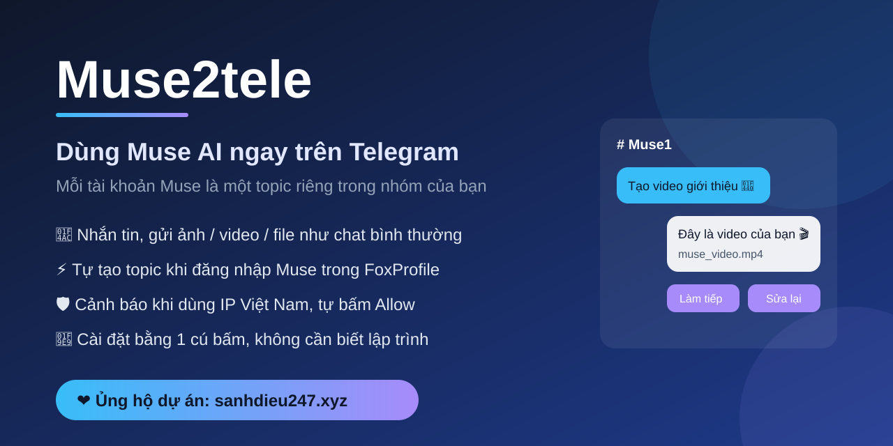

# Muse2tele — Dùng Muse ngay trên Telegram



> ❤️ **Ủng hộ dự án:** nếu Muse2tele giúp ích cho bạn, hãy ghé **[sanhdieu247.xyz](https://sanhdieu247.xyz)** để ủng
> hộ và theo dõi các bản cập nhật mới.

Muse2tele nối các tài khoản **Muse (muse.ai)** của bạn với **một nhóm Telegram**:

- Mỗi profile trong FoxProfile (mỗi tài khoản Muse) có **một topic riêng** trong nhóm.
- Bạn nhắn tin, gửi ảnh/video/file vào topic, bot gõ vào Muse giúp bạn.
- Câu trả lời của Muse (chữ, ảnh, video, file, nút bấm) tự hiện lại trong topic đó.
- Tạo profile mới và đăng nhập Muse xong là **bot tự tạo topic**, bạn không phải làm gì thêm.

> ⚠️ **Không dùng Muse bằng IP Việt Nam.** Muse có thể chặn hoặc khoá tài khoản. Mỗi profile trong FoxProfile
> cần gắn một **proxy nước ngoài** (Mỹ, Singapore, Nhật...). Bot tự kiểm tra và cảnh báo nếu một profile đang dùng
> IP Việt Nam.

---

## Bạn cần chuẩn bị

- Máy tính **Windows 10/11**, luôn bật và có Internet trong lúc dùng bot.
- Ứng dụng **Telegram** (trên điện thoại hoặc máy tính).
- Tài khoản **Muse** và **proxy nước ngoài** cho mỗi tài khoản.

---

## Bước 1 — Cài Python (làm 1 lần)

1. Vào <https://www.python.org/downloads/>, bấm nút vàng **Download Python**.
2. Mở file vừa tải. **Tick ô "Add python.exe to PATH"** ở dưới cùng, rồi bấm **Install Now**.
3. Chờ cài xong, bấm **Close**.

## Bước 2 — Cài Muse2tele (làm 1 lần)

1. Giải nén thư mục `Muse2tele` vào ổ đĩa, ví dụ `D:\Muse2tele`.
2. Mở thư mục, **bấm đúp vào `setup.bat`**.
3. Một cửa sổ đen hiện ra và tự cài mọi thứ (5–15 phút tuỳ mạng). Khi thấy chữ **CAI DAT XONG**, bấm phím bất kỳ
   để đóng.

## Bước 3 — Tạo bot Telegram (làm 1 lần)

1. Trên Telegram, tìm **@BotFather** (có dấu tích xanh) và bấm **Start**.
2. Gửi `/newbot`.
3. BotFather hỏi tên bot: gõ tên bất kỳ, ví dụ `Muse của tôi`.
4. BotFather hỏi username: gõ tên **kết thúc bằng `bot`**, ví dụ `museminh_bot`.
5. BotFather gửi lại một dòng **token** dạng `123456789:AAH...`. Bấm vào để sao chép.
6. Trong thư mục Muse2tele, mở file **`.env`** bằng Notepad (chuột phải → Open with → Notepad).
   Nếu chưa thấy file `.env`, cứ làm tiếp bước 4 — bot sẽ tự tạo và mở file này cho bạn.
7. Dán token vào sau dấu `=` ở dòng đầu, ví dụ:

   ```
   TELEGRAM_BOT_TOKEN=123456789:AAH...
   ```

8. Bấm **Ctrl + S** để lưu, rồi đóng Notepad.

> 🔒 Token giống như mật khẩu của bot. Không gửi token cho người khác.

## Bước 4 — Chạy chương trình

**Bấm đúp vào `start_all.bat`.** Hai cửa sổ sẽ mở:

- **FoxProfile**: ứng dụng quản lý trình duyệt / tài khoản Muse.
- **Muse2tele_Bot**: cửa sổ đen của bot. **Để nguyên cửa sổ này**, đóng là bot dừng.

Nếu cửa sổ bot báo **CHUA CO TOKEN** hoặc **TOKEN SAI**, làm lại Bước 3 rồi chạy lại `start_all.bat`.

## Bước 5 — Nhận quyền chủ bot

1. Trên Telegram, tìm bot vừa tạo (theo username ở Bước 3) và bấm **Start**.
2. Bot trả lời *"Bạn đã là chủ của bot này"* và gửi **bảng trạng thái** gồm các dấu ✅ / ❌, kèm
   **việc cần làm tiếp**. Cứ làm theo bảng đó; gõ `/start` bất cứ lúc nào để xem lại.

> Người đầu tiên bấm Start sẽ là chủ bot. Hãy tự làm bước này ngay sau khi tạo bot.

## Bước 6 — Tạo nhóm Telegram có Topic

1. Trên Telegram, tạo **Nhóm mới** (New Group), thêm bot của bạn vào nhóm.
2. Bấm vào tên nhóm → **✏️ Sửa (Edit)** → bật **Chủ đề (Topics)** → Lưu.
3. Vẫn trong phần sửa nhóm: **Quản trị viên (Administrators)** → **Thêm quản trị viên** → chọn bot →
   bật quyền **Quản lý chủ đề (Manage topics)** → Lưu.
4. Vào nhóm, gõ **`/setup`** và gửi. Bot trả lời ✅ là xong.

## Bước 7 — Thêm tài khoản Muse

Làm bước này cho **mỗi** tài khoản Muse:

1. Trong FoxProfile, bấm **tạo profile mới**. Đặt tên dễ nhớ (tên này sẽ là tên topic).
2. Ở ô **Proxy**, dán proxy **nước ngoài** của bạn. Bấm kiểm tra proxy nếu có nút kiểm tra, rồi lưu.
3. Bấm **mở (Launch)** profile. Một trình duyệt hiện ra.
4. Vào **muse.ai** và đăng nhập tài khoản Muse.
5. Chờ khoảng **1 phút**: trong nhóm Telegram tự xuất hiện **topic cùng tên profile** kèm lời chào. Xong!

Nếu topic chưa hiện sau vài phút, kiểm tra profile vẫn đang mở và đã vào được ô chat của Muse, rồi gõ `/start`
trong chat riêng với bot để xem bot đang chờ gì.

---

## Dùng hằng ngày

1. Bật máy, bấm đúp `start_all.bat`.
2. Trong FoxProfile, **mở các profile** bạn muốn dùng. Profile đang tắt thì bot không đọc được Muse của nó; mở lại
   thì bot tự gửi bù những tin Muse viết trong lúc đó.
3. Vào **topic** của profile và nhắn tin như chat bình thường.

Ý nghĩa biểu tượng trên tin của bạn:

| Biểu tượng | Ý nghĩa |
|---|---|
| 👀 | Bot đã nhận tin |
| 👍 | Đã gửi vào Muse |
| 👌 | Muse đã trả lời xong |
| 👎 | Lỗi, bot sẽ trả lời kèm lý do |

Mẹo:

- Gửi nhiều ảnh/video cùng lúc (album) sẽ thành **1 tin** trong Muse.
- **Trả lời (Reply)** một tin thì Muse biết bạn đang nói về tin nào.
- Muse đưa ra lựa chọn thì bot hiện **nút bấm**; bấm nút là gửi lựa chọn cho Muse.
- Bạn gõ trực tiếp trên web Muse thì câu trả lời vẫn hiện trong topic.
- Telegram chỉ cho bot nhận file **tối đa 20 MB** và gửi file **tối đa 50 MB**.

## Các lệnh của bot

| Lệnh | Gõ ở đâu | Tác dụng |
|---|---|---|
| `/start` | Chat riêng với bot | Xem trạng thái cấu hình và việc cần làm tiếp |
| `/setup` | Trong nhóm | Gắn nhóm này với bot |
| `/kiemtra` | Chat riêng hoặc nhóm | Kiểm tra IP từng profile, cảnh báo IP Việt Nam |
| `/allow_on`, `/allow_off` | Chat riêng hoặc nhóm | Bật / tắt việc bot tự bấm **Allow** khi Muse xin quyền (mặc định bật) |

Chỉ chủ bot dùng được `/setup`, `/kiemtra`, `/allow_on`, `/allow_off`. Mọi người trong nhóm đều nhắn được cho Muse
trong các topic, nên **chỉ thêm người bạn tin tưởng** vào nhóm.

---

## Gặp sự cố

| Hiện tượng | Cách xử lý |
|---|---|
| Bấm `setup.bat` báo **CHUA CAI PYTHON** | Làm lại Bước 1, nhớ tick **Add python.exe to PATH**. |
| Cửa sổ bot báo **CHUA CO TOKEN / TOKEN SAI** | Làm lại Bước 3, kiểm tra không thừa dấu cách trong `.env`. |
| Bot báo **Conflict 409** | Bot đang chạy ở máy/cửa sổ khác cùng token. Chỉ chạy **một** bot. |
| Bot cảnh báo 🚫 **IP Việt Nam** | Mở FoxProfile, sửa profile đó, gắn proxy nước ngoài, tắt rồi mở lại profile, gõ `/kiemtra`. |
| Không tự tạo topic | Gõ `/start` ở chat riêng với bot, làm theo dòng ❌ đầu tiên. Profile phải **đang mở** và **đã đăng nhập** Muse. |
| Lỡ xoá topic của profile | Bot tự tạo lại topic mới trong vài phút. |
| Muse không trả lời / báo lỗi | Bot tự tải lại trang và thử lại; trình duyệt treo thì bot tự khởi động lại profile. Tin gửi lúc Muse lỗi được xếp hàng và tự gửi lại. |

Nhật ký chi tiết của bot nằm ở `muse_telebot\muse_telebot.log` — gửi file này cho người hỗ trợ khi cần.

---

## ❤️ Ủng hộ dự án

Muse2tele được phát triển và chia sẻ miễn phí. Nếu bạn thấy hữu ích, hãy ủng hộ tại
**[sanhdieu247.xyz](https://sanhdieu247.xyz)** — mỗi sự ủng hộ giúp dự án tiếp tục được duy trì và cải tiến.

---

## Dành cho người kỹ thuật

```
Muse2tele\
  .env                      cấu hình cục bộ (token) — không chia sẻ / commit
  setup.bat                 cài .venv, thư viện, trình duyệt Camoufox
  start_all.bat             mở FoxProfile, chờ API, mở bot
  start_foxprofile.bat      chỉ mở FoxProfile (app + API http://127.0.0.1:8000)
  start_bot.bat             chỉ mở bot
  muse_telebot\
    muse_telebot.py         bot: topic ⇄ main chat Muse, tự tạo topic, hướng dẫn cấu hình, cảnh báo IP VN
    muse_sync.py            thao tác muse.ai qua REST của FoxProfile (gửi tin, đọc trả lời, tải media, ip-check)
    muse_auto.py            tự bấm Allow trên muse.ai
    muse_telebot_state.json chủ bot, nhóm, map profile → topic, id tin đã chuyển (bot tự tạo)
  foxprofile\
    foxprofile_client.py    client REST
    repo\                   ứng dụng FoxProfile
    data\                   dữ liệu profile (cookie, đăng nhập) — không chia sẻ / commit
```

- **Tạo topic:** mỗi 30 giây bot đọc danh sách profile của FoxProfile. Profile chưa có topic, đang chạy và hiện
  ô chat của `https://muse.ai/` (đã đăng nhập) thì bot tạo topic tên = tên profile. Bot không tự mở profile đang
  tắt. Profile bị xoá khỏi FoxProfile thì bot bỏ map; topic bị xoá trên Telegram thì bot tạo lại.
- **Đồng bộ:** tin trong topic → main chat Muse của profile (lỗi thì refresh, thử lại, khởi động lại trình duyệt;
  Muse lỗi kéo dài thì xếp hàng gửi lại mỗi 60 giây, tối đa 30 phút). Trả lời của Muse được đọc ngay sau khi gửi
  (relay) và mỗi 5 giây cho mọi topic (watch), mỗi tin chỉ chuyển một lần.
- **IP Việt Nam:** bot gọi `GET /api/v1/profiles/{name}/ip-check` của FoxProfile (đi qua proxy của profile) lúc
  khởi động, khi tạo topic, mỗi 6 giờ và khi gõ `/kiemtra`; quốc gia là VN thì cảnh báo trong topic và chat riêng.
- `MUSE_UPLOAD_DIR` phải nằm trong `FOXPROFILE_UPLOAD_DIRS`. Không chạy hai bot cùng token (Telegram báo 409).
